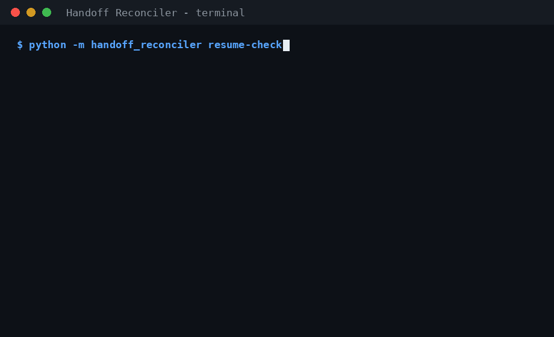

# Handoff Reconciler

**One-sentence job:** freeze a structured, machine-checkable handoff at the end of an AI coding session, then — at the start of the next session — verify every claim in it against git/test ground truth and print a traffic-light drift report instead of trusting the summary.



Python standard library only. Deterministic. No LLM inside the tool. The handoff schema is agent-neutral plain text (markdown + a JSON header block); v0 is used with Claude Code sessions, but nothing in the format or the checker is Claude-specific.

## Why

Agents write confident handoff prose: "auth refactor done, tests pass, next: wire the webhook." By the next session a human may have committed half of it away, another agent may have touched the same files, or the tests may no longer pass. Capture tools are everywhere; *verification* is the missing layer. This tool is that layer: claims are data, git is ground truth, and the output is a drift report plus a corrected resume pack (what is still true, what drifted, which next actions survive).

## MVP scope (v0)

- `freeze` — strict schema validation of an agent-written draft (JSON, or markdown containing exactly one ```` ```json ```` block); the **tool itself** fills the git snapshot (branch, HEAD, dirty-file list, and a **sha256 content hash for every claimed file**) and `frozen_at` if absent; writes `.handoff/HANDOFF.md` atomically, preserving any previous handoff as `.handoff/HANDOFF.prev.md`. Freezing outside a git repo fails loudly and writes nothing. A claimed file that does not exist (or is a directory) at freeze time is a freeze **error** — freeze records content hashes, and a claim about a missing path can never be reconciled honestly.
- `resume-check` — **read-only**. Reconciles: HEAD moved (ancestry-aware: N commits forward, explicit *moved backward*/rollback, or *history rewritten* when neither commit is an ancestor of the other; commits touching **only `.handoff/`** — the handoff's own commit — count as MATCH with an informational note), branch changed, claimed-finished files whose **content hash differs from freeze** (this catches dirty, committed, gitignored, and `assume-unchanged` edits uniformly), claimed files deleted or **renamed** (reported as DRIFT "renamed to …"), next-action target files that no longer exist (or were renamed), and the verify command's status.
- `show` — one-screen summary of the frozen handoff.
- Fixture corpus of scripted session stories in real temp git repos (see `tests/` and `ANALYSIS.md`).

### Explicitly NOT in v1

- No parsing of Claude Code / Codex / Cursor transcripts or native memory files (the agent writes the draft; the tool validates and verifies it).
- No automatic handoff *authoring* and no LLM summarisation anywhere.
- No GUI, daemon, server, cloud sync, or accounts — git is the sync layer.
- No other agents' native session formats; no team ledger / review gates (later ladder, see ANALYSIS.md).
- No handoff chains yet: only the latest `.handoff/HANDOFF.md` is reconciled (timestamped chain copies are a later, additive step).
- `resume-check` never writes to the repo, and never runs the verify command unless you explicitly pass `--run-verify`.

## Handoff format

`.handoff/HANDOFF.md` = human-readable markdown whose top block is one fenced ```` ```json ```` object:

```json
{
  "goal": "Ship the auth refactor",
  "agent": "claude-code",
  "tasks": [
    {"id": "t1", "title": "Refactor app.py", "status": "done_claimed"},
    {"id": "t2", "title": "Drop the legacy helper", "status": "rejected", "reason": "still imported by util.py"},
    {"id": "t3", "title": "Wire the webhook in util.py", "status": "next", "target_file": "util.py"}
  ],
  "files_claimed": ["app.py"],
  "verify_command": "python3 -m pytest -q",
  "frozen_at": "2026-11-10T21:07:54+00:00",
  "git": {"branch": "main", "head": "<filled by freeze>", "dirty_files": [],
          "file_hashes": {"app.py": "<sha256 of app.py at freeze, filled by freeze>"}}
}
```

Task statuses: `done_claimed`, `decided`, `rejected` (**reason required**), `next`, `on_hold`. Unknown fields, unknown statuses, malformed JSON, a `rejected` task without a reason, and unsafe paths (absolute, or containing `..`) all fail freeze with a clear error and exit 2. The draft must not contain a `git` block — freeze fills it, so a snapshot cannot be forged by the draft author.

## Usage

```bash
# 1. The outgoing agent writes a draft (see examples/draft.json), then:
python -m handoff_reconciler freeze --draft draft.json
# froze handoff -> .handoff/HANDOFF.md
# branch=main head=7a281ee899d8 dirty_at_freeze=0 tasks=4 files_claimed=2

# 2. Next session, before trusting anything:
python -m handoff_reconciler resume-check
```

Sample `resume-check` output (illustrative, in the shape of the real-world run in `ANALYSIS.md`; the command shown is the plain one above — no `--run-verify` — so the verify line correctly reads `NOT-RUN`):

```
# Handoff drift report
Goal: Extend SkillScan rule coverage after the v0.3 audit round
Frozen: 2026-11-10T21:07:54+00:00 by claude-code on branch main @ 7a281ee899d8

[DRIFT] HEAD moved -- 2 commit(s) since freeze (7a281ee899d8 -> 377bbea1c601)
[MATCH] branch 'main' -- unchanged
[DRIFT] file skillscan.py -- content differs from freeze; working tree is dirty in a file claimed finished
[DRIFT] file README.md -- content differs from freeze; changed by commits after freeze
[BROKEN] next-action target docs/AUDIT_COVERAGE.md -- target no longer exists (task: ...)
[NOT-RUN] verify command -- not run (pass --run-verify to run it); command is data, not executed

OVERALL: BROKEN
## Corrected resume pack
Still true: ...  Drifted (usable with care): ...  Broken (do not trust the claim): ...
Next actions that survive: ...
```

Run from any repo with `--repo PATH` if you are not inside it. `python -m handoff_reconciler show` prints the frozen summary.

### Exit codes (`resume-check`)

| Code | Meaning |
|---|---|
| 0 | All claims MATCH (verify command is MATCH or explicitly NOT-RUN) |
| 1 | DRIFT present, nothing BROKEN |
| 2 | BROKEN claim, or a tool error (no handoff, malformed handoff, not a git repo) |

`freeze` / `show`: 0 = ok, 2 = validation or tool error.

## Security: why `--run-verify` exists and defaults to off

A handoff file in a repo you cloned could have been written by anyone. Its `verify_command` is therefore treated as **untrusted data**:

- `resume-check` **never runs it by default** — it reports `NOT-RUN`.
- Only with the explicit `--run-verify` flag does the tool run it: the command is **printed before it runs**, executed in the repo root with a timeout (default 120s, `--verify-timeout N`, must be 1..3600 or it's a usage error), in its own process group (a timeout kills the whole group, not just the shell), with bounded output capture (only the last 64KB per stream is ever held). Its exit code becomes exactly one claim result (MATCH / BROKEN); on failure the report includes a bounded tail (last 20 lines / 4KB) of its output. A whitespace-only `verify_command` counts as no command.
- Every other handoff field (`goal`, task titles, paths, …) is data only. The tool invokes git through argv lists, never a shell, so shell metacharacters in those fields cannot execute (covered by a dedicated fixture test).
- The git snapshot inside a handoff is **strictly validated at load time**: `git.head` must be a full commit hash (`^[0-9a-f]{40,64}$`), `git.branch` a string, `git.dirty_files` a list of strings, `git.file_hashes` a path→sha256 map exactly matching `files_claimed`, and unknown fields inside `git` are rejected — any violation is a clean `ERROR` with exit 2. This matters because snapshot values are passed to git as arguments: a crafted `head` like `--output=/tmp/x` would otherwise become a git *option* and could write files during a supposedly read-only check. (Regression-tested.)
- Freeze refuses to write through a symlink: if `.handoff`, `HANDOFF.md`, or `HANDOFF.prev.md` is a symlink or resolves outside the repo root, freeze fails with exit 2.
- Path safety: `files_claimed` and task `target_file` values must be relative paths with no `..` component; anything else is rejected at freeze *and* at resume-check load time. `./x` is normalised to `x`; `.` itself is rejected (it is a directory, not a file).
- `resume-check` is read-only by construction: it performs no writes anywhere, including outside `.handoff/`.

**Handoff integrity, stated honestly:** beyond the strict format validation above, a handoff's integrity relies on the file living in git history — hand-edits to `.handoff/HANDOFF.md` are visible as diffs/commits there, and the content hashes let a reader spot a baseline that does not match the frozen tree's history. There is **no signing** in v0: anyone who can rewrite both the handoff and the repo history can forge a baseline. Strict format validation is the v0 mitigation; cryptographic signing is out of scope.

Residual risk, stated plainly: `--run-verify` runs a shell command from the file by design — only use it on handoffs you froze yourself or have read first. The printed-before-running behaviour is there so a human sees exactly what is about to execute.

## GitHub Action

Check-only drift report in CI (never `--run-verify`), written to the job summary:

```yaml
- uses: actions/checkout@v4
  with: { fetch-depth: 0 }
- uses: <owner>/handoff-reconciler@v0.1
```

**The job never fails.** The action is informational by design: it always exits 0, drift is reported in the job summary (with the checker's real exit code preserved there), and nothing is blocked. Gating a workflow on drift is a deliberate opt-in a team adds itself. The example workflow preserves the code through its `tee` pipeline with `pipefail` + `PIPESTATUS`, so the summary shows the true code rather than `tee`'s.

See `action.yml` and `.github/workflows/example-resume-check.yml`.

## Tests

```bash
python run_tests.py        # or: python -m unittest discover -s tests
```

51 tests, all passing: the original 14 fixture stories (`tests/test_handoff.py`) plus 37 adversarial-review regression tests (`tests/test_regressions.py`), each mapped to a reviewer finding (see `ANALYSIS.md` for the corpus design, per-fixture expected vs actual verdicts, the hand-labelled real-world run, and the fix-pass section).

## Benchmarks

Measured on the v0.1 tree with the reproducible corpora in `benchmark/` (see `BENCHMARK_RESULTS.md` for the full report — our own rates on our own corpus only):

- **Planted-drift corpus:** 20 / 20 planted drifts caught (file content, false claims, commit/branch state, verify failures, next-action targets), **0 / 12 false alarms** on accurate handoffs.
- **Dogfood on real project trees:** 24 / 24 claims correct across three real projects, 0 false alarms.
- **Foreign handoffs:** formats the tool does not understand fail with a clean, loud `ERROR` (never a silent misread); drafts from other agents written in the documented schema reconcile fully.

## Licence

MIT — see `LICENSE`.


---

**More from this workshop:** [SkillScan](https://github.com/RakTikoo/skillscan) · [KiCad Preflight](https://github.com/RakTikoo/kicad-preflight) · [Expiry Radar](https://github.com/RakTikoo/expiry-radar) · [CI Command Truth](https://github.com/RakTikoo/ci-command-truth) · [PhantomDep PR Gate](https://github.com/RakTikoo/phantomdep-pr-gate) · [Stranger Suite](https://github.com/RakTikoo/stranger-suite) · [Living Contract Diff](https://github.com/RakTikoo/living-contract-diff)
